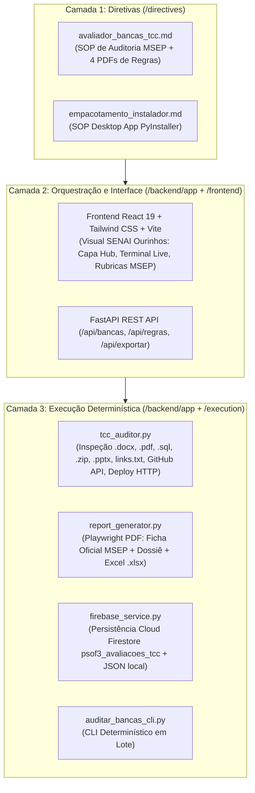

# 📐 Plano de Projeto e Relatório Técnico de Auditoria — Avaliador de Bancas TCC (PSOF3 — SENAI Ourinhos)

## 1. Visão Geral e Arquitetura de 3 Camadas (`/agente-orquestrador`)

O sistema **Central de Agentes Inteligentes SENAI Ourinhos — Avaliador de Bancas TCC (PSOF3)** foi projetado sob a **Arquitetura de 3 Camadas** para separar responsabilidades probabilísticas (IA/Orquestração) da execução determinística e auditável:

---

## 2. Mapeamento Integral dos 4 Documentos Oficiais (`./tcc/regras/`)

| Documento Oficial | Regra Extraída e Implementada no Motor (`regras_msep.py` & `tcc_auditor.py`) |
| :--- | :--- |
| **`agendamentos_tcc_senai_geral.pdf`** | Catálogo oficial das **25 bancas agendadas** (**13** na turma `I2DEV-A` em 25/11 e 02/12/2026; **12** na turma `I2DEV-B` em 26/11 e 03/12/2026), com horários (`08h00` a `16h00`), nomes de grupos, temas e integrantes. Vinculação automática das subpastas entregues em `./tcc/I2DEV-A` e `./tcc/I2DEV-B` ao agendamento oficial. |
| **`PSOF3_Formulario_Rubricas_MSEP_Banca.pdf`** | Matriz completa dos **4 Pilares MSEP (100 pontos)** e **18 subcritérios** com avaliação em 3 níveis (`Insuficiente`, `Pleno`, `Avançado`), notas individuais por integrante (`P1 + P2 + P3 + P4`) e status (`Aprovado >= 60` / `Reavaliar < 60`). |
| **`PSOF3_Relacao_Entregaveis_e_Criterios.pdf`** | Validação profunda dos 7 entregáveis obrigatórios: Monografia ABNT (`.docx` e `.pdf`), Script SQL (`.sql` com DDL, PK/FK e **mínimo de 20 registros `INSERT` por tabela**), Pacote Fonte (`.zip` sem `node_modules`/`.venv` e sem segredos `.env`), Apresentação (`.pptx`/`.pdf`), e `links.txt` (GitHub ativo + Deploy em nuvem ativo). |
| **`PSOF3_Roteiro_Apresentacao_Banca_TCC.pdf`** | Validação da estrutura de slides em **7 etapas** (25–30 min: Abertura, Problema, Solução, Demonstração ao Vivo, Arquitetura/Banco, Conclusão e Arguição Técnica) e auditoria rigorosa da **Nomenclatura Digital Obrigatória**: `CTDS-2026-02-[Tipo]-[Nome do projeto]-[Primeiro nome dos integrantes]`. |

---

## 3. Análise Detalhada dos 3 Grupos Entregues até o Momento (`tcc/I2DEV-B`)

### 📊 Resumo Comparativo Pré-Banca (Pilares 1, 2 e Item 3.3)

| Ordem / Grupo | Projeto | Integrantes | Conformidade Nomenclatura | Monografia (`.docx`/`.pdf`) | Banco de Dados (`.sql`) | GitHub & Deploy (`links.txt`) | Pré-Banca Sugerida (`P1 + P2 + 3.3`) |
| :--- | :--- | :--- | :--- | :--- | :--- | :--- | :--- |
| **Banca 01 — Grupo 08** (`26/11 08h00`) | **OrganizAI** *(Finanças)* | João Sergio, Leonardo, Ramon | **100%** (7/7 arquivos no padrão `CTDS-2026-02`) | 4.996 palavras (~36 págs.), 8 RFs, 8 RNFs | 3 tabelas (`profiles`, `metas`, `metas_pagamentos`), RLS + Triggers, **0 `INSERT`s** ⚠️ | GitHub HTTP 200 (11 commits) / Deploy Vercel HTTP 200 | **66.5 / 74.0 pts** *(Pleno/Avançado)* |
| **Banca 02 — Grupo 03** (`26/11 09h10`) | **Guardião Animal** *(Causa Animal)* | Arthur, Davi K, Vinicius | **95%** (dupla extensão `.pdf.pdf` no TCC PDF) | 11.166 palavras (~63 págs.), 22 RFs, 15 RNFs | 12 tabelas (PostgreSQL/Supabase), RLS + Índices, **0 `INSERT`s** ⚠️ | GitHub HTTP 200 (1 commit) / Deploy HTTP 200 | **64.5 / 74.0 pts** *(Pleno/Avançado)* |
| **Banca 03 — Grupo 05** (`26/11 10h30`) | **Risk Zero** *(CyberSecurity)* | Felipe, Miguel, Nikolas | **80%** (sufixos `.pdf (1).docx`, `.pdf.pptx`, `Felipe-.pdf`) | 13.840 palavras (~69 págs.), 25 RFs, 15 RNFs | 8 tabelas (`users`, `devices`, `incidents`, etc.), **176 `INSERT`s (22/tabela)** ✅ | **GitHub em branco** ⚠️ / Deploy Vercel HTTP 200 | **66.5 / 74.0 pts** *(Pleno/Avançado)* |

---

### 🔍 Detalhamento Individual por Grupo Auditado

#### 3.1. Banca 01 (I2DEV-B) — Grupo 08: OrganizAI (Gestão Financeira Inteligente)
* **Integrantes:** João Sergio, Leonardo, Ramon
* **Horário Oficial:** `26/11/2026 — 08h00 às 09h00`
* **Entregáveis Auditados:**
  * **Nomenclatura (`CTDS-2026-02`):** **100% conforme** nos 7 arquivos (`APRES` em `.pdf` e `.pptx`, `BD` em `.sql`, `COD` em `.zip`, `TCC` em `.docx` e `.pdf`, e `links.txt`).
  * **Monografia ABNT:** 4.996 palavras (~36 páginas estimadas), 27 seções estruturadas, 8 Requisitos Funcionais (RF) e 8 Requisitos Não Funcionais (RNF), resumo/abstract, diagramas de arquitetura, DER e testes documentados.
  * **Banco de Dados (`.sql`):** 3 tabelas (`public.profiles`, `public.metas`, `public.metas_pagamentos`), chaves primárias/estrangeiras, Row Level Security (RLS) e Triggers do Supabase configurados. **Ponto Crítico (Rubrica 2.3):** O script contém apenas DDL (`CREATE TABLE` / `CREATE POLICY`) e **0 registros `INSERT INTO`**, descumprindo a exigência mínima de 20 registros por tabela para testes.
  * **Código-Fonte (`.zip`):** 60 arquivos de código (`.ts`, `.tsx`, `.css`, `.sql`), stack React + TypeScript + Vite + Tailwind + Supabase + Gemini AI (`src/services/gemini.ts`, `src/pages/Simulador.tsx`, `src/pages/Investimentos.tsx`). Pacote limpo (sem `node_modules` e sem `.env` vazado).
  * **Repositório e Deploy:** GitHub ativo (`https://github.com/leuz3ra/organizai.git`, 11 commits) e Deploy ativo na Vercel (`https://organizai-theta.vercel.app`, HTTP 200).
* **Relatórios Gerados:**
  * [Ficha_MSEP_I2DEV-B_Grupo_08_OrganizAI.pdf](file:///g:/antigravity/projetos/antigravity.PSOF3BancasTCC/downloads_relatorios/Ficha_MSEP_I2DEV-B_Grupo_08_OrganizAI.pdf)
  * [Dossie_Auditoria_I2DEV-B_Grupo_08_OrganizAI.pdf](file:///g:/antigravity/projetos/antigravity.PSOF3BancasTCC/downloads_relatorios/Dossie_Auditoria_I2DEV-B_Grupo_08_OrganizAI.pdf)

#### 3.2. Banca 02 (I2DEV-B) — Grupo 03: Guardião Animal (Denúncias e Adoção Responsável)
* **Integrantes:** Arthur, Davi K, Vinicius
* **Horário Oficial:** `26/11/2026 — 09h10 às 10h10`
* **Entregáveis Auditados:**
  * **Nomenclatura (`CTDS-2026-02`):** **95% conforme** — o arquivo `CTDS-2026-02-TCC-GuardiaoAnimal-DaviK-Vinicius-Arthur.pdf.pdf` possui dupla extensão `.pdf.pdf`.
  * **Monografia ABNT:** 11.166 palavras (~63 páginas), excelente profundidade documental com 22 RFs e 15 RNFs, modelagem DER completa e documentação de testes.
  * **Banco de Dados (`.sql`):** 12 tabelas relacionais (`usuarios`, `ongs`, `animais`, `denuncias`, `adocoes`, `campanhas`, `doacoes`, `mensagens_chat`, `notificacoes`, `historico_status_denuncia`, `fotos_animais`, `avaliacoes_ong`), views e políticas RLS. **Ponto Crítico (Rubrica 2.3):** Possui **0 comandos `INSERT INTO`** (há um comentário explícito no final do `.sql` informando que os dados de exemplo foram omitidos), violando a regra de >= 20 registros por tabela.
  * **Código-Fonte (`.zip`):** 66 arquivos de código (`app.js`, `denuncia.js`, `adocao.js`, `mapa.js`, `ong-dashboard.js`, etc.), pacote limpo.
  * **Repositório e Deploy:** GitHub ativo (`https://github.com/dkalmeidatheking/guardiaoanimaltcc.git`, porém com apenas 1 commit concentrado) e Deploy ativo (`https://guardiaoanimal.fwh.is/`, HTTP 200).
* **Relatórios Gerados:**
  * [Ficha_MSEP_I2DEV-B_Grupo_03_Guardião_Animal.pdf](file:///g:/antigravity/projetos/antigravity.PSOF3BancasTCC/downloads_relatorios/Ficha_MSEP_I2DEV-B_Grupo_03_Guardi%C3%A3o_Animal.pdf)
  * [Dossie_Auditoria_I2DEV-B_Grupo_03_Guardião_Animal.pdf](file:///g:/antigravity/projetos/antigravity.PSOF3BancasTCC/downloads_relatorios/Dossie_Auditoria_I2DEV-B_Grupo_03_Guardi%C3%A3o_Animal.pdf)

#### 3.3. Banca 03 (I2DEV-B) — Grupo 05: Risk Zero / CyberSecurity (Monitoramento de Riscos e Cofre Digital)
* **Integrantes:** Felipe, Miguel, Nikolas
* **Horário Oficial:** `26/11/2026 — 10h30 às 11h30`
* **Entregáveis Auditados:**
  * **Nomenclatura (`CTDS-2026-02`):** **80% conforme** — múltiplos arquivos apresentam artefatos de download no nome (`CTDS-2026-02-TCC-RiskZero-Felipe-Miguel-Nikolas.pdf (1).docx`, `.pdf (1).pdf`, `.pdf.pptx`, `CTDS-2026-02-APRES-RiskZero-Miguel-Nikolas-Felipe-.pdf`).
  * **Monografia ABNT:** 13.840 palavras (~69 páginas), 25 RFs e 15 RNFs, cobertura completa de arquitetura, criptografia, LGPD/ISO 27001 e testes.
  * **Banco de Dados (`.sql`):** **100% Conforme!** 8 tabelas (`users`, `devices`, `security_Diagnostics`, `vault_items`, `incidents`, `alerts`, `audit_logs`, `compliance_checklists`) e **176 registros inseridos via `INSERT INTO` (exatamente 22 registros por tabela)**, cumprindo integralmente a regra de >= 20 registros por tabela.
  * **Código-Fonte (`.zip`):** 60 arquivos de código React + TypeScript (`src/pages/Vault.tsx`, `src/pages/Scanner.tsx`, `src/pages/Incidents.tsx`, `src/lib/crypto.ts`, etc.), pacote limpo.
  * **Repositório e Deploy:** Deploy ativo na Vercel (`https://riskzero-vault.vercel.app/`, HTTP 200), porém **o campo `GitHub:` foi deixado em branco no arquivo `links.txt`** (Ponto Crítico nas Rubricas 2.2 e 2.6).
* **Relatórios Gerados:**
  * [Ficha_MSEP_I2DEV-B_Grupo_05_Risk_Zero_CyberSecurity.pdf](file:///g:/antigravity/projetos/antigravity.PSOF3BancasTCC/downloads_relatorios/Ficha_MSEP_I2DEV-B_Grupo_05_Risk_Zero_CyberSecurity.pdf)
  * [Dossie_Auditoria_I2DEV-B_Grupo_05_Risk_Zero_CyberSecurity.pdf](file:///g:/antigravity/projetos/antigravity.PSOF3BancasTCC/downloads_relatorios/Dossie_Auditoria_I2DEV-B_Grupo_05_Risk_Zero_CyberSecurity.pdf)
